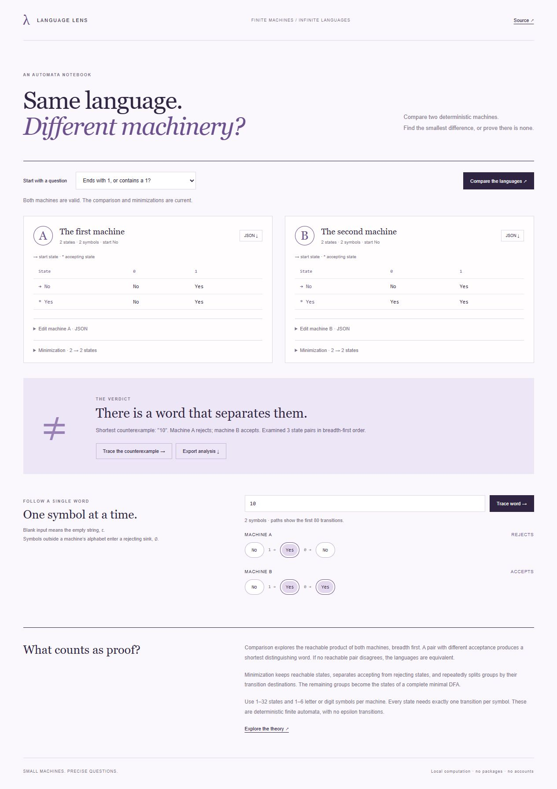

# Language Lens

A finite-automata notebook that answers two concrete questions: do these machines accept the same language, and how much of each machine is actually necessary?

Compare complete deterministic finite automata, find a shortest distinguishing input, minimize reachable states, and trace individual words through both machines. Export JSON models, a full analysis, or Graphviz DOT files.



## Run

```sh
python run.py --port 8000
```

Open http://127.0.0.1:8000. Python 3.10+ serves the interface; no runtime packages, accounts, API keys, fonts, or external services are needed. Computation runs locally in the browser. Export before refreshing if you want to retain edits.

## Three starting questions

- **Five states versus two:** two machines recognize binary strings with an even number of `1` symbols. The larger machine has one unreachable state and two pairs of equivalent reachable states. It minimizes from five states to two without changing its language.
- **Ends with 1 versus contains a 1:** the shortest counterexample is `10`. The first machine rejects it and the second accepts it.
- **The empty string:** if start-state acceptance differs, the shortest witness is `ε`, represented internally by the empty string `""`. It is a valid witness, not a missing result.

JSON editors and minimization details are collapsible. Editing either machine invalidates the previous tables, verdict, paths, and exports until you compare again. **Use minimized A/B** replaces that editor's machine with its complete minimum and immediately rechecks equivalence with the other machine.

## Machine format

```json
{
  "states": ["E", "O"],
  "alphabet": ["0", "1"],
  "start": "E",
  "accept": ["E"],
  "transitions": [
    ["E", "0", "E"],
    ["E", "1", "O"],
    ["O", "0", "O"],
    ["O", "1", "E"]
  ]
}
```

Requirements:

- 1–32 distinct states. Names start with a letter, followed by up to 15 letters, digits, or underscores.
- 1–6 distinct alphabet symbols, each one ASCII letter or digit. Matching is case-sensitive.
- One declared start state and zero or more distinct declared accepting states.
- Exactly one `[from, symbol, to]` transition for every state/symbol pair. Missing, duplicate, and undeclared transitions are errors.
- Only the five documented top-level fields are accepted. JSON text is limited to 50,000 characters; imported files to 200 KB with strict UTF-8 decoding.

These are complete DFAs. There are no nondeterministic choices, regular-expression parsing, or epsilon transitions. The empty *input word* is supported.

## Algorithms and semantics

**Equivalence:** breadth-first search over reachable pairs of states, using the sorted union of the two alphabets. Symbols outside a particular machine's alphabet lead to an implicit rejecting sink, displayed as `∅`, which loops on every symbol. The first acceptance mismatch yields a shortest witness by parent-pointer reconstruction. Among equally short witnesses, sorted-symbol traversal makes the choice deterministic. Exhausting the reachable product without a mismatch proves equivalence; this is not bounded word sampling.

**Minimization:** first remove states unreachable from the start. Partition the remaining states into accepting and rejecting groups, then repeatedly split each group according to the destination-group signature of its outgoing transitions. Once stable, each group becomes a state. Output states are named `q0`, `q1`, … in reachable breadth-first order, with `q0` the start. This is iterative partition refinement, not Hopcroft's optimized algorithm. The export includes groups, unreachable states, and refinement rounds.

**Word tracing:** accepts up to 2,000 JavaScript string code units, consumes Unicode code points, and rejects any out-of-alphabet symbol through the sink. The displayed path is capped at the first 80 transitions; the final acceptance result always uses the complete word, and long traces show the final state separately. Blank input displays `ε`.

For n and m states and k union symbols, comparison is O((n+1)(m+1)k). The extra states account for implicit sinks when alphabets differ. Minimization is O(n²k) with this bounded implementation. The input limits keep both operations small enough for interactive browser use.

## Exports

- **Machine JSON:** the five-field model above; can be imported into either editor.
- **Analysis JSON:** both validated machines, both minimization results, and the equivalence result, including witness paths when different. This is a report, not a machine-import file.
- **DOT:** a deterministic Graphviz graph with accepting states double-circled and a separate entry arrow. Graphviz is not required to run the app; rendering the exported graph is optional.

## Verify

Node.js 22+ and Python 3.10+:

```sh
node --test
npm run check
python -m unittest discover -s tests -v
```

Nine JavaScript tests cover strict model validation, empty and nonempty witnesses, different alphabets, unreachable states, all-accepting/all-rejecting machines, and nonmutation. Generated machines are checked against an independent transition interpreter across all binary words through length six; each pair of distinct minimized states must have a distinguishing word. All pairs of 16 small unary machines are also compared against independent length-ordered enumeration. A Python test checks static server asset boundaries, Host validation, and HEAD behavior.

Browser checks cover the five-to-two-state reduction, preserved equivalence, `10` and empty-string witnesses, stale-result invalidation, invalid JSON models, and machine-file export/import. CI runs Linux with Node 22/24 and Windows with Node 24.

## Structure and background

`core.js` contains pure model operations, `app.js` connects them to the notebook, and `run.py` is a loopback-only development server with an asset allowlist and restrictive content security policy. It is not a production server.

[Cornell's compiler notes on DFA equivalence and minimization](https://www.cs.cornell.edu/courses/cs4120/2026sp/notes/leximpl/) explain why equivalent states can be merged without changing the recognized language.
